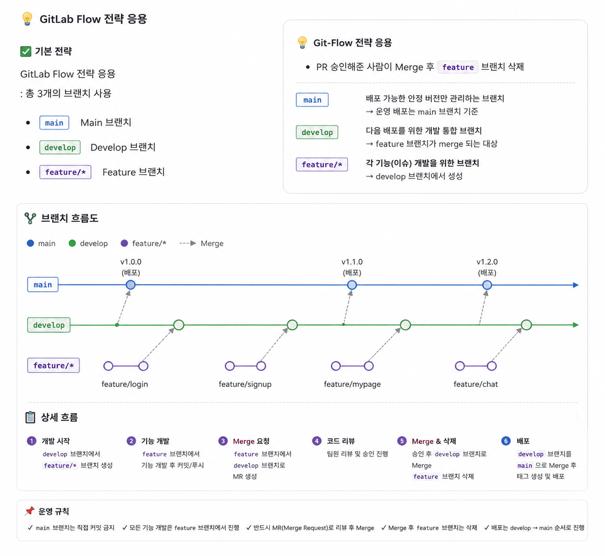

# Git Branch 전략

---

## 기본 전략

GitLab Flow 전략 응용

: 총 3개의 브랜치 사용

- Main 브랜치
- Develop 브랜치
- Feature 브랜치

<aside>
💡

**Git-Flow 전략 응용**

- PR 승인해준 사람이 Merge 후 `feature` 브랜치 삭제
</aside>

---

## **기본 브랜치**

### Main 브랜치 ( 예: `main`, `master` )

- **목적**
    - 항상 배포 가능한, **안정적인 상태를 유지**하는 브랜치
    - 제품 릴리즈 또는 프로덕션 환경에 배포할 때 사용
- **특징**
    - 새로운 기능이나 변경 사항이 바로 적용되지 않으며, 테스트와 검증을 거친 후에만 병합

### Develop 브랜치 ( 예: `develop`, `dev` )

- **목적**
    - `main` 브랜치의 안정성을 보호하기 위해 **모든 개발된 사항이 통합**되는 브랜치
    - 여러 기능이 개발 중일 때, `feature` 브랜치들이 Merge되는 중심 역할
- **특징**
    - 개발 중인 코드가 모이는 브랜치로, 불안정성이 존재하지만
    - 최종 릴리즈 전 `release` 브랜치에서 테스트 및 코드 리뷰 진행

### Feature 브랜치 ( 예: `feature/login` )

- **목적**
    - **각 기능을 개발**하는 브랜치 ( 여러 개 존재 )
- **특징**
    - `develop` 브랜치에서 브랜치를 생성해 → 개발 완료 후 → `develop` 브랜치로 merge 후 → 삭제
    - `feature/` 뒤에 개발할 기능을 적어 기능별 각 브랜치 구분

### Release 브랜치 ( 예: `release` )

- **목적**
    - 특정 버전 개발이 모두 완료된 후 **최종 릴리즈 전 테스트 및 코드 리뷰**를 진행하는 브랜치
- **특징**
    - `develop` 브랜치에서 브랜치를 생성해 → 테스트 후 → `main` 브랜치로 merge 후 → 배포

### Hotfix 브랜치 ( 예: `hotfix` )

- **목적**
    - `main` 브랜치에서 릴리즈 후 **급한 버그가 발생했을 때 빠르게 버그 수정**하는 브랜치
- **특징**
    - `main` 브랜치에서 브랜치를 생성해 → 버그 수정 후 → `main` 브랜치로 다시 merge

---

## 추가 브랜치

### Refactor 브랜치 ( 예: `refactor/featrue-name` )

- **목적**:  `feature`  브랜치에서 `develop` 브랜치로 merge하기 전 코드 리팩토링을 위한 브랜치

### Bugfix 브랜치 ( 예: `bugfix/issue-name` )

- **목적**: `feature`  브랜치에서 발견한 일반적인 버그를 수정하는 브랜치

### Docs 브랜치 ( 예: `docs` )

- **목적**: 문서 관련 정리 ( ex. README.md )

---