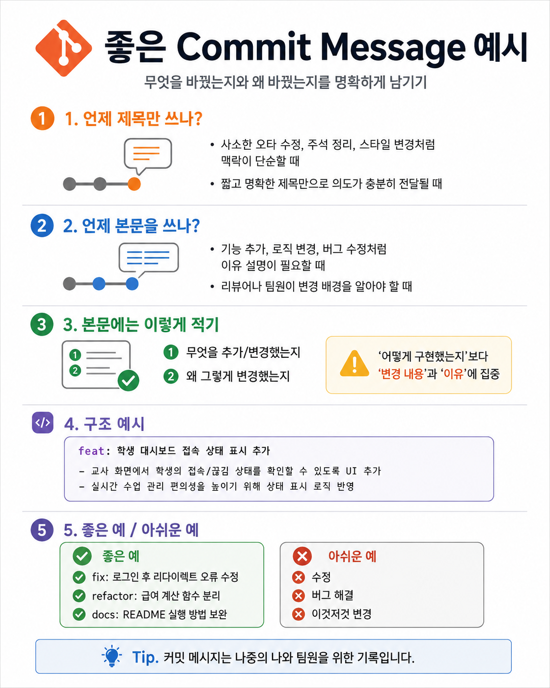

# Git Commit 규칙

## 1. Git 기본 규칙

<aside>
⚠️

1. **`main` 브랜치는 직접 수정 금지!**
    - `main` 브랜치는 **배포용 브랜치**이므로, 직접 수정하지 않고 **항상 `feature` 브랜치에서 작업**
2. **`develop` 브랜치에서 `feature` 브랜치 생성 후 기능 개발**
    - `develop` 브랜치를 기반으로 기능별 브랜치 생성
    
    ```bash
    git switch develop
    git pull origin develop        # 최신 dev 내용 가져오기 ( 권장 )
    git switch -c feature/기능명    # Git 2.23부터 지원 )
    git checkout -b feature/기능명  # 기존 방식
    ```
    
3. **`feature` 브랜치의 Commit은 최대한 기능 단위로 작게, 세세하게 쪼개서 작성**
    - 최대한 작은 단위로 쪼개서 작성하기
4. **기능 개발 후 PR 전 최신 개발 내역을 반영하기 위해 pull ( 원격 `develop` → `feature` )**
    - 팀 규칙에 따라 `merge` 또는 `rebase` 중 하나 선택
    
    ```bash
    git switch develop
    git pull origin develop    # 원격 develop의 최신 내용 가져오기
    git switch featrue/기능명
    git merge develop
    ```
    
    또는
    
    ```bash
    git switch feature/기능명
    git fetch origin
    git rebase origin/develop   # feature 브랜치에 develop 내용 가져오기
    ```
    
5. **`feature` 브랜치에서 commit & push ( 원격 `feature` 브랜치 )**
    
    ```bash
    git switch feature/기능명
    git add .                        # 변경된 파일을 staging 영역에 추가
    git commit -m "Commit Message"   # Commit Message 작성법 참고
    git push origin feature/기능명   # 원격 feature 브랜치로 push
    ```
    
6. **Pull Request(PR) 요청 ( GitHub / GitLab )**
    - 기능 개발 완료 후 GitHub / GitLab에서 PR을 생성하여 `develop` 브랜치로 병합
    - PR 승인한 사람이 merge 및 `feature` 브랜치 삭제 진행
    - Pull Request Template 참고
</aside>

## 2. Commit Message 작성법

<aside>
🔥 **Commit Message 작성 방법**

1. 커밋 메시지 제목만 필요한지, 본문이 필요한지 구분
2. 본문에는 추가 or 변경 내용과 이유를 적는다.
    1. 무엇을 추가 or 변경 했는지와 그 이유를 적는다.
    2. ‘어떻게’는 지양한다.
</aside>



> https://gitmoji.dev/
> 

| 이모지 | 유형 | 설명 | 예시에서 이모지랑 유형만 복사하기 |
| --- | --- | --- | --- |
| 🎉 **:tada:** | `Init` | 프로젝트 초기화 커밋 | `🎉 Init: 프로젝트 초기 설정` |
| ✨ **:sparkles:** | `Feat` | 새로운 기능 추가 | `✨ Feat: 사용자 인증 기능 추가`
`✨ Feat: 로그아웃 버튼 위치 변경` |
| 🔧 **:wrench:** | `Fix` | 버그 수정 | `🐛 Fix: 토큰 만료 문제 해결
 🐛 Fix: 회원가입 시 생년월일 오류 수정` |
| 🏗 **:building_construction:** | `Build` | 빌드 시스템 변경 
또는 외부 의존성 수정 | `🏗 Build: Dockerfile 추가
 🏗 Build: Gradle 버전 업그레이드` |
| ✏️ :pencil2: | `Chore` | 기타 작업, 설정 변경
( 기능 변화와 무관한 작업 ) | `✏️ Chore: .env.example 파일 업데이트`
`✏️ Chore: 프로젝트 디렉토리 정리` |
| 📦️ :package: | `CI` | CI/CD 설정 수정 
(GitHub Actions, Jenkins 등) | `📦️ CI: GitHub Actions 테스트 워크플로 추가` |
| 📝 **:memo:** | `Docs` | 문서 수정 (README, 주석 등) | `📝 Docs: README 설치 방법 업데이트` |
| 🏷️ :label: | `Style` | 코드 포맷팅, 스타일 수정 
(기능 변경 없음) | `🏷️ Style: 들여쓰기 및 세미콜론 정리` |
| ♻️ **:recycle:** | `Refactor` | 코드 리팩토링 (기능 변경 없음) | `♻️ Refactor: 중복된 유저 검증 로직 제거` |
| ✅ **:white_check_mark:** | `Test` | 테스트 코드 | `✅ Test: 로그인 기능 단위 테스트 추가` |
| ⚡️ **:zap:** | `Performance` | 성능 개선 | `⚡️ Perf: 게시글 조회 시 쿼리 최적화` |
| ⏪️ :rewind: | `Revert` | 커밋 되돌리기 | `⏪️ Revert: JWT 인증 로직 변경 커밋 되돌림` |
| 🚀 **:rocket:** | `Release`  | 버전 릴리즈 | `🚀 Release: v1.0.0 버전 릴리즈` |

<aside>
⚡

**적용 예시 (간단한 경우)**

```bash
# git commit -m "<태그>: <설명>"
# <설명>  -> 가능하면 영문으로작성 지향, 필수는X

git commit -m "🎉 Init: Spring Boot 초기 설정"
git commit -m "🏗 Build: .gitignore 파일 설정"
git commit -m "✨ Feat: CustomUser 모델 추가"
git commit -m "✏️ Chore: .env.example에 AUTH_USER_MODEL 설정 추가"
git commit -m "✨ Feat: 사용자 인증 기능 추가"
git commit -m "✨ Feat: 회원가입 API 구현"
git commit -m "🔧 Fix: 로그인 시 비밀번호 검증 오류 수정"
git commit -m "✏️ Chore: CORS 설정 추가"
git commit -m "✏️ Chore: DEBUG 모드를 False로 변경"
git commit -m "📝 Docs: README.md 업데이트"
```

</aside>

## 3. `PULL_REQUEST_TEMPLATE` 관리

- 주로 `.github/PULL_REQUEST_TEMPLATE/` 경로에서 다양한 템플릿 관리
- GitHub에서 PR 만들 때 → 템플릿 선택 화면이 자동으로 생성됨
    
    ```
    .github/
    ├── PULL_REQUEST_TEMPLATE/
    │   ├── feature_request.md
    │   ├── bug_fix.md
    │   └── docs_update.md
    ```
    
- `feature_request.md` ( `feature` 브랜치 → `develop` 브랜치로 PR )
    - 일반적으로 단일 템플릿을 사용할 때 `.github/pull_request_template.md`의 역할
    
    ```
    # 🚀 기능 추가 PR
    
    ## ✨ 개요
    <!---- 추가한 기능을 간단히 요약 -->
    - 
    
    ## 🛠 변경사항
    <!---- 어떤 파일/모듈을 수정하거나 추가했는지 -->
    - 
    
    ## 🔗 관련 이슈
    <!---- 이슈 번호: #번호 -->
    - 
    
    ## ✅ 체크리스트
    - [ ] 신규 기능 동작을 테스트했습니다.
    - [ ] 문서(README 등) 업데이트가 필요한 경우 수정했습니다.
    - [ ] 기존 기능에 영향이 없는지 확인했습니다.
    
    ## 📸 스크린샷 (필요시)
    <!---- UI 관련 변경사항이 있을 경우 첨부 -->
    
    ```
    
    - `.github/pull_request_template.md` 단일 템플릿 사용할 때
        
        ```
        # 📌 Pull Request 제목 (간결하고 명확한 제목 작성)
        
        ## ✨ 변경사항 요약
        <!---- 변경 사항 및 관련 이슈에 대해 간단하게 작성해주세요. -->
        <!---- Resolves: #(Isuue Number) -->
        
        ---
        
        ## 🔗 관련 이슈
        <!-- 관련된 이슈 번호 작성 (ex: #123) -->
        
        ---
        
        ## 📂 PR 타입 (체크해주세요)
        - [ ] Feat: 새로운 기능 추가
        - [ ] Fix: 버그 수정
        - [ ] Refactor: 코드 리팩토링
        - [ ] Style: 코드 포맷팅, UI 스타일 수정 (CSS 등)
        - [ ] Test: 테스트 코드 추가 및 보완
        - [ ] Docs: 문서 수정 (README 등)
        - [ ] Chore: 빌드 업무 수정, 패키지 매니저 설정 수정
        - [ ] Move: 파일 이동
        - [ ] Del: 파일/코드 삭제
        
        ---
        
        ## ✅ 체크리스트
        - [ ] 코드가 정상적으로 동작합니다.
        - [ ] 새로운 테스트를 추가하거나 기존 테스트를 통과했습니다.
        - [ ] 문서(README 등)를 최신 상태로 유지했습니다.
        - [ ] 기존 기능에 영향이 없음을 확인했습니다.
        
        ---
        
        ## 📸 스크린샷 (선택)
        <!-- 변경된 UI나 주요 동작 화면이 있다면 첨부해주세요. -->
        
        ---
        
        ## 📝 특이사항
        <!-- 코드 리뷰 시 중점적으로 봐야 할 부분이나, 추가로 설명이 필요한 부분을 작성해주세요. -->
        ```
        
    
- `bug_fix.md` ( `hotfix` 브랜치 → `main` 브랜치로 PR )
    - `main` 브랜치에서 발생한 긴급 버그 수정 후 PR
    - ex) `hotfix/긴급버그수정` → `main`
    
    ```
    # 🐛 버그 수정 PR
    
    ## 🔥 문제 상황
    <!---- 발생했던 문제를 간단히 설명 -->
    <!---- 가능하다면, 버그가 발생했던 당시 혹은 도움이 되는 스크린샷 첨부 -->
    - 
    
    ## 🔧 해결 방법
    <!---- 문제를 어떻게 해결했는지 구체적으로 -->
    - 
    
    ## 🔗 관련 이슈
    <!---- 이슈 번호: #번호 -->
    - 
    
    ## ✅ 체크리스트
    - [ ] 수정한 부분에 대한 테스트를 수행했습니다.
    - [ ] 기존 기능이 정상 동작하는지 확인했습니다.
    
    ## 📋 기타
    <!---- 특이사항, 주의사항 등 -->
    - 
    ```
    
    - **자동으로 이슈를 닫는 키워드**
        
        <aside>
        
        GitHub에서 이슈를 커밋할 때 특정 키워드를 사용하면 자동으로 해당 이슈가 닫힙니다.
        
        ### ✅ 자동으로 이슈를 닫는 키워드
        
        아래 키워드 중 하나를 커밋 메시지에 포함하면 이슈가 자동으로 닫힙니다.
        
        - `Fixes #이슈번호`
        - `Closes #이슈번호`
        - `Resolves #이슈번호`
        
        💡 **예시**
        
        ```
        git commit -m "Fixes #42: 로그인 버그 수정"
        ```
        
        ```
        git commit -m "Closes #123: 레시피 추천 알고리즘 개선"
        ```
        
        ```
        git commit -m "Resolves #10: DB 마이그레이션 문제 해결"
        ```
        
        ### 🛠 여러 개의 이슈 닫기
        
        한 번의 커밋으로 여러 개의 이슈를 닫을 수도 있습니다.
        
        ```
        git commit -m "Fixes #42, Fixes #56, Closes #78"
        ```
        
        ### 🚀 푸시 후 적용되도록 하기
        
        커밋 후 원격 저장소에 푸시해야 적용됩니다.
        
        ```bash
        git push origin 브랜치이름
        ```
        
        </aside>
        
    
- `docs_update.md` ( `docs` 브랜치 → `develop` 브랜치로 PR )
    - `develop` 브랜치에서 `README.md`같은 문서 관련만 수정할 때 사용하는 PR
    - ex) `docs/README-업데이트` → `develop`
    
    ```
    # 📝 문서 수정/추가 PR
    
    ## 📚 작업 내용
    <!-- 수정하거나 추가한 문서 내용을 설명 -->
    - 
    
    ## 🔗 관련 이슈
    <!-- 이슈 번호: #번호 -->
    - 
    
    ## ✅ 체크리스트
    - [ ] 문법 오류나 오타를 수정했습니다.
    - [ ] 문서 구조를 명확하게 개선했습니다.
    - [ ] 필요한 경우 예제 코드나 링크를 추가했습니다.
    
    ## 📋 기타
    <!-- 추가로 알리고 싶은 내용 -->
    - 
    ```
    

## 4. 스크립트 관리

- 주로 `.scripts/` 경로에서 다양한 스크립트 관리
- 직접 수동 실행할 수 있도록 별도 스크립트 화 ( 자동 + 수동 모두 지원 )

```bash
/.git/
.github/
.husky/
  └─ pre-commit    # Git hook에서 자동 실행 (lint/format/test)
scripts/
  └─ pre-commit.sh  # 커밋 전 실행되는 스크립트
```

- `.husky/pre-commit`
    - `.husky/` 폴더를 사용하면 Git hook을 관리
    - `pre-commit` hook을 자동으로 실행하려면 `.husky/pre-commit` 파일에 `pre-commit.sh`를 호출하는 명령을 추가
    - 커밋 전에 `pre-commit` hook이 실행되며, 이때 `pre-commit.sh` 스크립트가 호출되어 위에서 설정한 코드 검사, 테스트 등이 자동으로 실행
    
    ```bash
    # 예시
    
    #!/bin/sh
    . ./scripts/pre-commit.sh
    ```
    
    - Husky 설치 방법 ( 이미 설치된 경우 생략 가능 )
        
        ```bash
        npm install husky --save-dev
        npx husky install
        ```
        
    
- `scripts/pre-commit.sh` ( 프로젝트에 맞게 수정 필요 )
    - 주로 코드 스타일 검사, 문법 체크, 테스트 실행 등을 자동화하여, 커밋하기 전에 코드를 깔끔하게 다듬고 품질을 보장하는 데 사용
    - Spring Boot 예시
        
        > Spring Boot 프로젝트에서 **Java 코드 스타일 검사**와 **단위 테스트**를 자동으로 실행하는 스크립트
        > 
        - `Checkstyle`과 `SpotBugs`는 Maven을 통해 실행되며, Gradle을 사용하는 경우에는 주석을 제거하고 `./gradlew` 명령어를 사용
        - `./mvnw test` 명령어는 JUnit 테스트를 실행
        
        ```bash
        #!/bin/bash
        
        # 1. 코드 스타일 검사 (Checkstyle)
        echo "Running Checkstyle (Spring Boot)..."
        ./mvnw checkstyle:check # Maven 사용 시
        # ./gradlew checkstyleMain # Gradle 사용 시
        
        # 2. 코드 품질 검사 (SpotBugs)
        echo "Running SpotBugs (Spring Boot)..."
        ./mvnw spotbugs:check # Maven 사용 시
        # ./gradlew spotbugsMain # Gradle 사용 시
        
        # 3. Spring Boot 테스트 실행 (JUnit)
        echo "Running Spring Boot Tests..."
        ./mvnw test # Maven 사용 시
        # ./gradlew test # Gradle 사용 시
        
        # 4. 변경된 파일 리스트 보여주기 (선택적)
        echo "Changed files:"
        git diff --name-only --cached
        
        # 5. 종료
        exit 0
        
        ```
        
    - FastAPI 예시
        
        > FastAPI 프로젝트에서 **Python 코드 스타일 검사**와 **단위 테스트**를 자동으로 실행하는 스크립트
        > 
        - **Flake8**은 Python의 코드 스타일 검사 도구
        - **Black**은 코드 포맷을 자동으로 스타일링하지만, `--check` 플래그를 사용하면 변경 없이 검사만 수행
        - **pytest**는 FastAPI의 테스트를 실행
        
        ```bash
        #!/bin/bash
        
        # 1. 코드 스타일 검사 (Flake8)
        echo "Running Flake8 (FastAPI)..."
        flake8 .
        
        # 2. 코드 포맷 검사 (Black)
        echo "Running Black (FastAPI)..."
        black --check .
        
        # 3. FastAPI 테스트 실행 (pytest)
        echo "Running FastAPI Tests..."
        pytest --maxfail=1 --disable-warnings -q
        
        # 4. 변경된 파일 리스트 보여주기 (선택적)
        echo "Changed files:"
        git diff --name-only --cached
        
        # 5. 종료
        exit 0
        
        ```
        
    - React 예시
        
        > React 프로젝트에서 **코드 스타일과 포맷 검사 및 테스트**를 실행하는 스크립트
        > 
        - **`npx eslint . --fix`**
            - `eslint`를 사용하여 프로젝트 내 모든 파일의 코드 스타일을 검사하고, 가능하면 자동으로 수정
        - **`npx prettier --check .`**
            - `prettier` 를 사용해 코드 포맷을 검사합니다.
            - 이때 `--check`플래그는 파일을 수정하지 않고 검사만 수행
        - **`npx jest --bail --maxWorkers=4`**
            - `jest`테스트 실행
            - 이때 `--bail` 플래그는 테스트 중 실패한 경우 즉시 중단되도록 하며,
            - `--maxWorkers=4`는 테스트를 병렬로 실행하여 속도를 개선
        
        ```bash
        #!/bin/bash
        
        # 1. 코드 스타일 검사 (ESLint)
        echo "Running ESLint (React)..."
        npx eslint . --fix
        
        # 2. 코드 포맷 검사 (Prettier)
        echo "Running Prettier (React)..."
        npx prettier --check .
        
        # 3. 테스트 실행 (Jest)
        echo "Running Tests (React)..."
        npx jest --bail --maxWorkers=4
        
        # 4. 변경된 파일 리스트 보여주기 (선택적)
        echo "Changed files:"
        git diff --name-only --cached
        
        # 5. 종료
        exit 0
        
        ```
        

---