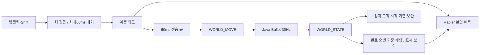

# 이동 경로 분석과 표시 안정화

2026-10-29. 분석 기준은 `cb1542c`와 이번 로컬 변경이다. 서버·DB·인증·게임 규칙을 변경하지 않았다. 개발 서버 배포나 로블록스와 동등한 체감 달성을 주장하지 않는다.

## 1. 확인한 원인

| 관찰 | 코드 근거 | 확인 범위 |
| --- | --- | --- |
| 방향키·Shift·키 해제가 로컬 예측에도 최대60ms 늦게 반영 | `world/input.ts: installRoamingInput`의 키 집합과 주기적 `sendIntent`; `SpringParkRuntime.move → localMovement.intend` | 실제 DOM 키 이벤트24회 중 짧은 입력10회가 이동 의도 갱신 전에 끝남. 키→runtime p95 59.2ms |
| 이전 요청 실패가 이후 입력한 점프를 지움 | `SpringParkRuntime.sendMovement` catch의 `movement.clear(false)` | 기존 런타임 테스트도 삭제를 기대하고 있었음. 새 회귀로 재현 후 큐 삭제 제거 |
| 큰 정상 오차가 한 프레임 순간이동으로 바뀜 | `LocalMovementPrediction.reconcile`의 같은 epoch 오차 범위 초과→`displayed=undefined` | 실제 loopback Java+Chrome에서8.1ms 사이3.194m 표시 이동, 강제 보정1회 확인. 공식 서버 좌표가 아닌 표시 초기화 경로 |
| 원격 표시 속도가 패킷 도착 간격을 따름 | `worldClient.receive → sampleMovement`의 도착 시각마다120ms 보간 재시작 | 합성9m/s 궤적의0~60ms 지터 비교. 기존 속도 표준편차3.06~3.19m/s |

Java Bullet과 FE Rapier는 다른 엔진이고, 스텝·접지·충돌 결과도 완전히 같지 않다. 이는 오차 발생 조건이지만 사용자에게 보인 모든 점프맵 현상의 단독 원인으로 단정하지 않는다. 이전 표시 경로의 이중 충돌 검사 제거는 `cb1542c`의 별도 수정이며 이번에 새로 한 일로 중복 계산하지 않는다.

## 2. 기존 실행 경로



### 백엔드

- `TableWebSocketHandler → TableHub.moveWorld → WorldChannelRegistry.input → WorldPhysics.input`: 소켓 사용자·채널·맵·활동 상태를 검사한다. 클라이언트는 seq/dx/dz/run/jump만 전송한다.
- `MoveInput.parse`: 허용 키, 유한 수, 방향 정규화, 불리언, 순번을 검사한다. 좌표·dt·클라이언트 timestamp를 받을 수 없다.
- `WorldChannelRegistry.input`: 평균50ms당1개 예산·순간4개 버스트. 중복/과거 순번은 입력 유효시간을 연장하지 않는다.
- `WorldPhysics`: Minie9.0.3 / Libbulletjme22.0.3, 고정30Hz, 걷기6.25m/s·달리기9m/s·일반 점프6.2m/s·중력−18m/s². 지형별 수영·탑 점프 예외는 기존 설정을 사용한다. 입력 유효기간250ms.
- `TableHub.advanceWorld`: 약33ms fixed-delay 호출, registry는 최대3회 catch-up 후 과도한 경과 시간을 버린다. 따라서 서버 tick을 벽시계와 영구히 같은 속도라고 가정할 수 없다.
- 변경된 월드 방송은 약100ms 간격이다. 각 이동 요청에는 물리 계산 전의 수락 응답도 반환할 수 있다. 수락 `position.lastInputSeq`와 실제 적용 `motion.appliedInputSeq`는 다르다.
- `WorldPhysics.recover`는 비정상 위치/지형 관통 복구를 수행하며 epoch를 바꾼다. 일반 낙하와 복구 구분은 `WorldFallRecoveryTests`로 확인했다. 별도의 POSITION 메시지는 없다.
- 허브 잠금·물리 실행기 join·소켓 송신 큐의 실제 운영 지연 기여도는 이번에 측정하지 않았다.

### 프론트와 직접 위치 변경

- `input.ts`: WASD·Shift·Space·카메라 방향에서 이동 의도를 만든다. `MovementInputBuffer`가 요청 주기를 제한한다.
- `predictionPhysics.reset`: 본인 예측 Rapier 몸체에 `setTranslation/setNextKinematicTranslation`; `step`은 controller 결과를 kinematic 몸체에 적용한다. WASM0.21.0, 최대1/60초 서브스텝이다.
- `localMovementPrediction.reconcile/advance`: 서버 완료 입력부터 남은 로컬 의도를 재생한다. 렌더 위치와 물리 위치는 별도이며 예측은 마지막 서버 확인 후 최대250ms다.
- `worldClient.receive/refreshActivityPresentation`: 공식 위치 캐시를 갱신하고 승인된 테이블·시설 표시 위치를 적용한다. 표시 예측은 `authoritativePose`를 바꾸지 않는다.
- `Avatars`의 `useFrame`: `sampleAvatar` 결과를 Three root의 position/rotation에 반영한다. `avatarMotion`은 모델 내부 모션·뼈대를 움직이며 root 이동 권한을 바꾸지 않는다.
- `CameraRig`: 동일한 `sampleAvatar`를 카메라 목표로 사용한다. 표시 보정과 별개로 카메라 충돌을 처리한다.
- React 사용자 key와 모델 memo는 유지된다. 매 서버 메시지마다 remount되어 위치가 초기화된다는 근거는 찾지 못했다.

### 요청한8개 점검의 결론

| 질문 | 결론 |
| --- | --- |
| 내 좌표를 매 응답 덮어쓰는가 | 공식 캐시·예측 물리는 갱신하지만 표시 root는 sampleAvatar를 거친다. 큰 오차의 표시 초기화가 실제 스냅 원인이었음 |
| 두 이동 계산이 다른가 | 엔진/스텝/입력 도착 시점이 다르며 동일 Bullet 궤적 재생에서도 보정 잔차가 발생함 |
| 오래된 좌표를 적용하는가 | 과거 WORLD_STATE.version·motion.tick은 제외. 더 늦게 도착한 최신 상태 자체의 노후도까지 완벽히 아는 생성 시각은 없음 |
| 입력을 중복 적용하는가 | 자동 재전송 없음. 완료 순번·점프 소비를 별도로 추적. 이전 실패의 새 점프 삭제 결함은 확인 |
| 보정과 물리가 충돌하는가 | 기존 이중 표시 충돌 검사는 이전 커밋에서 제거됨. 이번에는 큰 오차의 display reset을 확인 |
| 주기적으로 보정되는가 | 새 완료 스냅샷마다 재조정 가능. 지연·물리 차이로 반복 오차는 남으며 측정값에 기록 |
| 상대를 즉시 이동시키는가 | 기존에도 보간은 있었음. 다만 수신마다 재시작하며 source tick 버퍼는 없었음 |
| React 초기화인가 | 이를 뒷받침하는 코드/재현 없음 |

## 3. 채택한 수정과 기각한 대안

1. 키·Shift·해제·카메라 회전 시 로컬 의도를 즉시 갱신한다. 네트워크 전송 주기60ms는 분리해 유지한다. 빠른 중간 의도는 여전히 전송 큐에서 합쳐질 수 있다.
2. 이전 이동 실패는 해당 입력만 거절 표시하고 새 대기 점프를 보존한다.
3. 같은 epoch의 표시 위치는 오차 크기로 즉시 초기화하지 않는다. 잔차 목표80ms, 수평12.125m/s·수직20m/s 추격 상한을 적용한다. 큰 오차는 더 오래 수렴하며 일시적인 모델 겹침이 가능하다. 서버의 명시적 epoch 변경은 즉시 반영한다.
4. 원격 캐릭터는 최대16개 source-tick 스냅샷·180ms 표시 지연을 사용한다. 중복·역순·epoch·활동 전환·채널/맵 전환을 처리한다. 누락 때 외삽하지 않고 대기한다. 서버 catch-up 폐기 후에는 최근16개/2초 시계 창으로 회복하며 표시 tick은 역행하지 않는다.
5. RTT16개와 보정 진단64개를 로컬 메모리에만 둔다. RTT는 매칭 입력의0~500ms 표본만 보관하며 보정 진단의 roundTripMs는 최근 표본의 최솟값이다. 장기 지연/전체 RTT 분포 측정기가 아니다. 반 RTT를 anchor에 더하는 실험은 기각했다. RTT200ms 점프 발판의 최대 보정 오차가0.105m→0.833m로 악화됐고 계단 개선만으로 전체 도입할 수 없었다.

**이번에는 서버 권위를 유지한다.** 확인한 입력·큐·표시 초기화 결함은 좌표 권위를 바꾸지 않고 고칠 수 있다. client-driven 좌표 방식은 검토했지만 이번 관찰만으로 필수라고 판단하지 않았다. 전환하면 예측/서버 궤적 불일치 보정은 줄일 수 있는 반면, 속도·수직 궤적·충돌 통과 검증, 따라가기·시설 고정·epoch 정책과 양쪽 프로토콜을 함께 다시 설계해야 한다. 입력 방식 결함과 엔진 불일치를 구분하기 전에 그 비용을 도입하지 않는다. 사용자 체감이 계속 불충분하면 해당 전환을 비교할 근거로 이번 잔차·지연 기록을 사용한다.

## 4. 보안과 기존 상호작용

- 최종 좌표·속도·중력·충돌·입력 순번·서버 시간·활동 제한은 그대로다. 좌표나 timestamp를 전송하는 새 프로토콜은 추가하지 않았다. 보안 검증을 완화하지 않았다.
- 시설, 소리함/메모함, 근거리 채팅·관전의 서버 위치 판정은 표시 위치와 분리된다. 게임·정산·인증·DB 코드는 수정하지 않았다.
- 기존 보장 범위를 과장하지 않는다. 현재 테이블 join은 같은 채널/정원/중복 착석을 검사하지만 별도 접근 거리 검사로 확인되지 않았고, ShopService.purchase에도 월드 위치 검사는 없다. 이는 이번 변경이 만든 허점은 아니지만, 이 두 기능까지 위치 기반 접근이 완비됐다고 말할 수 없다. 별도 제품 계약 확인이 필요하다.

## 5. 측정 결과와 재현

| 검사 | 결과 | 해석 한계 |
| --- | --- | --- |
| 실제 DOM 키24회 | 누락10→0, key→runtime p95 59.2→0.3ms; 최종 최대0.8ms | 합성 인증·전송 브라우저. 물리 키보드→픽셀/운영 지연이 아님 |
| 동일 DOM 시나리오 송신 | 2.534초30개/3033B → 2.559초38개/3844B | 즉시 stop 등 추가 의도가 반영되므로 총량은 증가. 최소59ms 이상 간격 확인 |
| 실제 loopback Chrome+Java | 수정 중3.194m/8.1ms 스냅1회 재현. 최종 준비된 화면에서강제보정0·최대잔차0.608m·JS오류0 | 별도 실행이며 스케줄링/프레임 간격이 동일하지 않으므로 개선율 계산 안 함. 로그인은 로컬 대역, DB 없음 |
| 실제 Bullet7시나리오 × RTT0/50/100/200 | 28조건 통과; 같은 수신 시각 표시 점프0, 강제보정0, 마지막 잔차최대약0.0021m | 지연을 제어한 FE 리플레이. 빠른 좌우·계단의 중간 오차는 최대약1.65m로 남음 |
| Bullet28조건 + ordered 지터0~45ms + 매9번째 상태 생략 | 28조건 통과, 강제보정0, 최종잔차최대약0.0032m | 실제 TCP 패킷 손실이 아닌 애플리케이션 상태 누락 |
| 원격9m/s·10Hz·60Hz표시·지터0~60ms | 180ms버퍼의 속도 표준편차는 수치 오차 수준, 기존3.06~3.19m/s. 한 프레임 최대0.203→0.150m | 합성 등속 궤적. 표시 지연60ms 증가 비용 포함 |
| 같은 원격 비교 + 일부 상태 생략 | 표준편차4.63~4.69→2.04~2.24m/s, 최대프레임0.281→0.202m | 완벽한 연속성 보장 아님. 실제 TCP 손실은 재전송·head-of-line 지연으로 나타남 |

실제 loopback 준비 후4.661초 동안 WORLD_MOVE52개/5233B, WORLD_STATE82개/175067B를 수집했다. 이 값은 단일 로컬 시나리오 관찰이며 서버 처리량이나 비용 개선 수치가 아니다. 전체 FE 단위1185통과/선택3스킵, 타입·프로덕션 빌드 성공. 관련 BE22통과. 선택 비교는 별도 실행했으며 일반 테스트의 스킵을 실패로 숨기지 않는다.

```powershell
# backend: 공유 DB/서버를 사용하지 않는 선택 비교
$env:TEST_MOVEMENT_PREDICTION_FRONTEND='true'
$env:MOVEMENT_COMPARISON_DIR='<로컬 결과 폴더>'
./gradlew.bat test --tests '*MovementPredictionFrontendTests'

# frontend: 같은 결과 폴더를 지정한 뒤
node node_modules/vitest/vitest.mjs run tests/unit/movementQuality.test.ts
node node_modules/@playwright/test/cli.js test tests/e2e/m02.spec.ts
```

## 6. 남은 검수

실제 두 계정·사용자 점프맵 경로·서버 부하·비대칭 지연·물리 엔진 차이의 체감 검수가 남는다. 유효한 서버 확인을250ms 넘게 받지 못하면 예측이 멈추는 정책도 유지한다. RTT 자체의250ms 기준은 아니다. 원격 버퍼의 재위상/누락 중 대기와 큰 오차 추격은 감춰진 한계가 아니다. 이번 로컬 결과를 전체 문제 해결·운영 적용으로 표시하지 않는다.

## 7. 후속: 표시 보정과 물리 재생 분리 진단

사용자가 제공한 이동 진단 프롬프트2개는 SHA256 기준 동일한 파일이었다. 문서의 실행 제안과 기존 사실을 구분하고, 우선 작은 A/B 실험을 수행했다. 렌더 진입점은 SpringParkRuntime 자체가 아니라 Avatars/CameraRig이므로 실제 경로로 계측했다. 이 단계는 제품 이동이나 프로토콜 변경이 아니다.

### 조건

- 기준cc86867. Java Bullet9종×RTT4종36개 궤적을 각3모드로108회 재생했다.
- baseline은 기존 경로, A는 표시 offset만 제거(물리reset/replay·표시속도상한 유지), B는 A에 같은epoch 물리reset/replay 생략을 추가한다. B도 fresh snapshot 기반250ms 기한과 epoch/활동 전환은 유지한다.
- 진단은 tests/diagnostics 안에만 존재하며 제품src에서 가져오지 않는다. 모드B의 최종 오차가 남아도 진단 결과로 저장하되, 정합성 합격으로 판정하지 않는다.
- 초기 달리기 경로는 실제 장애물에 닿아 속도 변동 해석에서 제외했다. 기존 원본을 보존한 뒤 같은 맵의 장애물 없는(-10,42) 구간으로 바로잡았다.
- 역방향 누적 거리는 직전 입력 방향과 표시 이동의 내적으로 계산한다. 입력 전환120ms 이내와 그 이후를 분리하고, 해당 표본이 없는 지표는0이 아니라null이다. 아래 좌우 반전은80ms 주기이므로 역방향 수치를 전부 비정상 이동으로 취급하지 않는다.

### 고정60Hz 비교: RTT100ms

| 항목 | baseline | A: offset제거 | B: A+reset/replay생략 |
| --- | --- | --- | --- |
| 직선 달리기 속도 표준편차(m/s) | 0.784 | 0.910 | 0.085 |
| Shift전환 후 안정구간 속도 표준편차(m/s) | 0.464 | 0.704 | 0.0013 |
| 빠른 좌우 반전 역방향 누적(m) | 0.704 | 2.059 | 0.535 |
| 계단 역방향 누적(m) | 0.300 | 0.740 | 0 |
| 계단 최종 서버 위치 차이(m) | 0.0020 | 0.0018 | 0.536 |

**판단:** 표시 offset만 끄는 것은 해결책으로 채택하지 않는다. A↔B에서 물리reset/replay가 속도 변동과 일부 역행에 기여하는 근거를 확보했다. 그러나 B는 계단0.536m·빠른좌우0.439m의 최종 서버 오차를 남기므로 그대로 제품에 적용할 수 없다. 사용자가 본 모든 순간이동의 단독 원인이 확정됐다는 의미도 아니다.

12.125m/s는 보정 추가속도가 아니라 전체 표시 이동 상한이다. 같은 방향으로9m/s 달리는 목표를 따라잡는 추가속도는 최대3.125m/s다. 또한0.6m의 진행방향 잔차를80ms에 줄이는 단순한 예에서는 −7.5m/s의 보정 성분이 생겨9m/s 이동이1.5m/s로 보일 수 있다. 이는 계산 예시이며 사용자의 특정 프레임에0.6m 수평 잔차가 발생했다고 단정한 측정값은 아니다.

### 실제 렌더와 남은 범위

Three.js 아바타·카메라를 포함해4종×3모드12조건도 재생했다. 모델position.set의 실제 호출 시각과 관측 시각을 분리하고 카메라 방향/quaternion을 기록했다. RTT100ms 단일 브라우저 실행에서 직선 달리기 속도 표준편차 baseline1.057/A0.939/B0.802m/s, 계단 역방향 누적0.328/0.609/0m가 관찰됐다. 고정60Hz와 개선 폭이 다르므로 고정시계 수치를 실제 브라우저 개선율로 일반화하지 않는다. 모델 위치 쓰기 시각은 GPU출력/사용자 체감 시각도 아니다. 카메라 고정 실험과 사람의 체감 합격은 아직 수행하지 않았다.

로컬 수동 패널은 기존/A/B 전환과 최근3000프레임·600키이벤트 JSONL 저장을 제공한다. 이동키만 기록하고 회원ID·채팅·토큰은 기록하지 않는다. 모드 전환 직후 초기화 구간은 비교에서 제외한다. 실제 Java loopback 접속의 세 모드 전환·버튼 직후 캔버스 포커스·간단한W/Shift입력은 확인했다. 서버 정책과 공식 위치 검증은 그대로이며 진단 모드가 클라이언트 권위 전환을 구현한 것은 아니다.

입력edge 전달 비교, 네트워크 없는 엔진별 접촉/점프 소비 대조, 서버 스냅샷 생성 시각/epoch 원인 로그, 카메라 고정 비교는 후속 범위다. 클라이언트 권위+서버 검증 대안은 B의 체감과 남은 정합성 비용을 함께 평가한 뒤 별도 프로토타입으로 비교한다.
